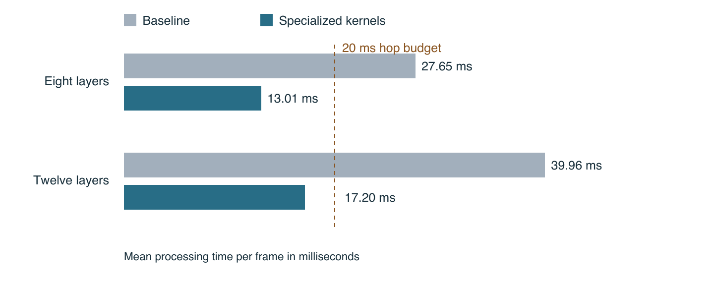

# Real time speech enhancement on iPhone with specialized Metal kernels

Technical report  |  RE-USE Apple project  |  26 October 2026

We reduced the processing time of NVIDIA Real-time RE-USE on an iPhone 13 Pro Max by changing how its existing computations execute on the GPU. In matched short tests, eight layers fell from 27.65 to 13.01 milliseconds per frame and twelve layers fell from 39.96 to 17.20 milliseconds. Reverse-order measurements confirmed the improvement.

The selected changes keep the checkpoint, layer count, FP32 precision and zero-lookahead configuration fixed. They combine a parallel temporal Mamba kernel, prepared frequency inputs and fused normalization. No retraining, quantization, frame skipping or audio gain adjustment was used.



Figure 1. First matched four-second pair at each depth. The reverse pairs showed 53.34% and 55.82% reductions respectively. These are processing times, not complete call latency.

### What the results establish

On the paired diagnostic recording, STOI changed by less than 0.000000004 in the short tests. Raw output differences were around 123–125 dB below output RMS. Separate recurrent-state and reset checks passed on the Mac. This supports numerical preservation for the tested cases; it is not a broad listening study.

The one-minute twelve-layer replay averaged 16.98 ms, with 17.27 ms p95. Seven of 3,001 frames exceeded 20 ms, so the result does not establish a guaranteed live-call deadline. The report explains the implementation, measurement controls, validation evidence and remaining work.

## 1 Model and measurement scope

### The model we optimized

Real-time RE-USE is a separate streaming model, with selectable exits from three through twelve layers and configurable lookahead. It is not the offline thirty-layer RE-USE model. NVIDIA describes a convolutional encoder and decoder with Mamba time–frequency modeling. The public checkpoint includes multiple exits; selecting an exit changes the active path. [1, 2]

Our measurements use the same pinned checkpoint at each comparison depth. Eight-layer baseline is compared with eight-layer optimized output; twelve-layer baseline is compared with twelve-layer optimized output. A speed comparison across different depths would confound implementation improvements with a change to the model.

| Measurement setting | Value |
| --- | --- |
| Device and software | iPhone 13 Pro Max • A15 • iOS 26.2.1 |
| Build and runtime | Release • Xcode 16.4 • MLX Swift 0.29.1 |
| Signal and framing | 16 kHz mono • 640-sample window • 320-sample hop |
| Model configuration | Eight or twelve layers • zero lookahead • FP32 |
| Short input | 4 seconds • 64,000 samples • 201 processed frames |
| Sustained input | Same 4 seconds repeated 15 times • 3,001 frames |

### What a frame measurement includes

The measured path includes audio analysis, the selected neural network, synthesis and GPU completion. Checkpoint loading and three warmup frames are separate. GPU work is evaluated before stopping the timer; simply timing asynchronous submission would understate the cost. Short comparisons were untraced, used the same installed binary and were repeated in reverse order.

Each 320-sample hop represents 20 ms of incoming audio. Mean processing below 20 ms is necessary for this serial implementation to keep up, but it is not enough to establish complete call performance. The 640-sample analysis window, microphone callbacks, buffering, echo cancellation, resampling, codecs, transport and playback also contribute delay.

### How we located the opportunity

A twenty-second Metal System Trace showed about 84% GPU execution coverage in the selected steady-state window. That made GPU computation a credible optimization target. The trace did not attribute time to individual shaders. We therefore used controlled ablations to establish which changes helped, and excluded trace-instrumented timings from speed claims.

The baseline already included earlier filtering, projection, frame-evaluation and compilation improvements. The reported 53–57% reduction is the additional gain from this kernel work, not a comparison against an unoptimized Python implementation.

## 2 Parallel temporal state updates

The largest measured improvement came from the temporal Mamba recurrence. At a given audio frame, the sixteen state components of one channel can be updated independently before their outputs are summed. The previous kernel assigned that work to one thread with a serial loop. The replacement assigns one component to each of sixteen cooperating SIMD lanes.

### The computation remains the same

For channel c and state component j, the implementation keeps the recurrence below. Here u is the filtered input, z is the output gate input, A and D are learned parameters, and B and C are input-dependent projections. Delta is the softplus of the rank-four time projection and its bias.

```text
delta[c] = softplus(projected_delta[c] + bias[c])
h_new[c,j] = exp(delta[c] × A[c,j]) × h_old[c,j] + delta[c] × B[j] × u[c]
y[c] = (sum_j h_new[c,j] × C[j] + D[c] × u[c]) × z[c] / (1 + exp(−z[c]))
```

The dependence from one audio frame to the next remains sequential. Parallelism is introduced across the sixteen state components within the current frame, not across future speech. Every recurrent state is retained and evaluated for use by the next frame.

### How work maps onto Apple SIMD lanes

| Property | Previous temporal kernel | Specialized temporal kernel |
| --- | --- | --- |
| State update | One thread loops over 16 components | 16 lanes update 16 components |
| SIMD32 assignment | Independent channel threads | Two independent 16-lane channels |
| Delta computation | Computed within channel work | Computed by channel leader and broadcast |
| Output reduction | Serial accumulation | Four-stage balanced SIMD reduction |
| State access | Neighboring threads stride between channels | Neighboring lanes read adjacent components |

The channel index is global_x / 16 and the state-component index is global_x modulo 16. The two channel leaders within a SIMD32 group are lanes 0 and 16. Each group reduces only its own sixteen components. For the audited [161, 256, 16] state layout, all 659,456 state elements and 41,216 output elements are written exactly once.

This exposes independent work, improves locality and shortens the reduction dependency chain. Those are plausible reasons for the measured improvement; the trace alone cannot establish their individual contributions. The mapping assumes the tested Apple SIMD32 path.

Changing serial addition into a balanced tree changes floating-point rounding. The kernel preserves the model equations but is not promised to be bit-identical. That is why waveform, recurrent-state and reset validation accompanied the timing measurements.

## 3 Frequency preparation and normalization

### Prepare shared frequency values once

In the frequency scan, delta and the output gate are shared by all sixteen state components at a frequency and channel. The prepared-frequency path computes the rank-four projection, stable softplus and gate once, then passes those values to the scan. It preserves the existing sequential recurrence across frequency bins and its reduction. It does not remove either direction of bidirectional frequency processing.

The gate keeps the same arithmetic expression, z / (1 + exp(−z)), rather than substituting an algebraically equivalent expression with different rounding. Prepared frequency alone was bit-identical in the tested output and state checks. The selected combination still has small differences because the other kernels reorder reductions.

### Fuse operations around normalization

The model repeatedly normalizes rows with exactly 64 channels. A specialized kernel assigns two channels per lane in a SIMD32 group. It calculates the mean, then centered variance, keeps epsilon at 0.00001, and applies the original learned scale and bias. It also performs the following PReLU or residual addition in that same dispatch.

This reduces intermediate operations and dispatch overhead without changing the normalization definition. Input shape and FP32 assumptions are checked. Reduction order can change the last few bits, so the accuracy checks test the full model rather than assuming a fused operation is automatically equivalent.

### The ablation that selected the final combination

| Eight-layer path in the second benchmark build | Mean ms per frame |
| --- | --- |
| Matched baseline | 27.649 |
| Prepared frequency and fused normalization | 23.440 |
| Those two plus parallel temporal scan | 13.012 |
| Precomputed frequency decay and normalization | 24.528 |
| Precomputed decay plus normalization and parallel temporal | 13.891 |

These component runs are exploratory ablations within the benchmark build, not independent confidence intervals. The matched baseline–selected-path comparisons, including reverse order, provide the stronger evidence for the final result. The ablation identifies parallel temporal execution as the largest observed component improvement.

A prototype also precomputed frequency decay exponentials. That introduced a [batch, frequency, 256, 16] scratch buffer and additional memory traffic; it was slower than the selected combination. Raising the command-buffer operation limits to 100 or 200 also gave no clear additional benefit. Neither change is part of the recommended path.

## 4 Latency and sustained behavior

All four matched short pairs started and ended at nominal thermal state with Low Power Mode off. Reversing the run order reduces the risk that one favorable run or warmup order explains the gain. The small number of trials does not establish a population-wide performance distribution.

| Short comparison | Baseline mean ms | Optimized mean ms | Reduction | Optimized p95 ms |
| --- | --- | --- | --- | --- |
| 8 layers pair A | 27.649 | 13.012 | 52.94% | 14.253 |
| 8 layers pair B | 28.062 | 13.094 | 53.34% | 14.914 |
| 12 layers pair A | 39.958 | 17.197 | 56.96% | 18.923 |
| 12 layers pair B | 38.920 | 17.194 | 55.82% | 19.150 |

The short eight-layer runs had zero and one frame above 20 ms out of 201 frames. The twelve-layer runs had four and six. Mean processing speed is therefore a useful capacity measure, while the tail of the distribution remains relevant to audio buffering and underruns.

### One minute of repeated audio

| Optimized sustained measurement | 8 layers | 12 layers |
| --- | --- | --- |
| Mean processing time | 14.036 ms | 16.977 ms |
| p95 processing time | 14.772 ms | 17.270 ms |
| p99 processing time | 15.260 ms | 17.953 ms |
| Maximum frame time | 18.761 ms | 26.570 ms |
| Frames above 20 ms | 0 / 3,001 | 7 / 3,001 |
| Time to process 60 seconds | 42.353 s | 51.135 s |
| Thermal state start to end | Serious to serious | Nominal to fair |

The long replay repeats one four-second recording fifteen times. It tests sustained execution and state propagation, not sixty seconds of diverse speech. Twelve-layer means over consecutive ten-second segments stayed between 16.93 and 17.01 ms. Sampled MLX allocation counters did not show sustained growth; these samples do not establish an absence of memory leaks or measure total process memory.

Long baseline and optimized runs had different thermal histories. The eight-layer baseline heated from nominal to serious before the optimized run; the twelve-layer optimized run preceded a baseline that heated from fair to serious. Consequently, the long runs must not be used as a controlled percentage-speedup comparison. The nominal short pairs establish the gain.

The twelve-layer sustained result is promising for a buffered streaming worker, but the seven deadline misses and unmeasured complete call path prevent a claim of guaranteed real-time calling performance.

## 5 Audio and recurrent state validation

Faster execution would be unhelpful if it changed the speech. We compared baseline and optimized raw waveforms using the same checkpoint and input, without gain matching or time alignment. Every output sample was checked for finiteness. STOI and SI-SDR were measured against the paired clean reference where available.

| Phone comparison | Baseline STOI | Optimized STOI | Relative waveform error |
| --- | --- | --- | --- |
| 8 layers short | 0.7182996299 | 0.7182996319 | −123.08 dB |
| 12 layers short | 0.7188348065 | 0.7188348030 | −125.05 dB |
| 8 layers repeated minute | 0.7242358753 | 0.7242358903 | −123.37 dB |
| 12 layers repeated minute | 0.7222435139 | 0.7222435174 | −122.71 dB |

Relative waveform error is 20 × log10(RMS(optimized − baseline) / RMS(baseline)). More negative values mean less implementation error. Short maximum absolute sample errors were about 2.14 × 10⁻⁷ at eight layers and 1.79 × 10⁻⁷ at twelve layers. The longest twelve-layer comparison reached 7.58 × 10⁻⁷. All long outputs contained 960,000 finite samples.

### State and reset checks on the Mac

A separately compiled Mac probe compared all retained states at frames 0, 1, 50, 100, 150 and 200. It covered 31 state tensors for eight layers and 39 for twelve layers, checking keys, shapes, FP32 dtype, finite values and numerical agreement. Each variant also reset and replayed exactly, checking both its waveform and sampled state hashes.

| Acceptance check | Threshold |
| --- | --- |
| Full waveform relative RMS error | At most 0.001 or −60 dB |
| Full waveform maximum absolute error | Below 0.0001 |
| Each state tensor | Relative RMS below 0.0001 or maximum error below 0.00001 |
| Paired STOI difference | Absolute difference at most 0.001 |
| Paired SI-SDR difference | Absolute difference at most 0.05 dB |

The measured waveform errors are well below these thresholds. The observed short STOI differences are roughly nine orders of magnitude smaller than one STOI unit. The checks support the conclusion that these kernels preserve the tested model behavior to FP32 numerical tolerance.

Phone timing and audio evidence must be distinguished from Mac internal-state evidence. Long internal-state snapshots were not instrumented on the phone. One diagnostic clip cannot establish general enhancement quality, speaker fidelity, robustness across languages, or perceptual equivalence on all inputs. The tiny eight-versus-twelve STOI difference here also cannot establish which depth sounds better in general.

## 6 Alternatives and integration boundaries

### Why the selected path remains FP32 Metal

Earlier tests did not show that changing inference frameworks or precision would automatically improve this model. The tested FP16 projection and hidden-convolution path was slower than its comparison. Moving small transform work to the CPU produced only small gains. Those experiments were not selected for the reported result.

A separate Core ML comparison measured about 32.38 ms per frame for a stateful FP16 CPU-and-GPU configuration, versus 27.40 ms for its MLX comparison. The explicit-state FP32 Core ML configuration measured about 54.24 ms. Automatic compute-unit selection encountered an execution-plan failure, so no Neural Engine acceleration was established. These are observations about the tested conversions, not a general verdict on Core ML.

Specializing the existing Metal execution path produced the useful gain while keeping the original checkpoint and FP32 precision. The important engineering change was exposing independent state-component work and avoiding repeated operations, not assuming a smaller numerical format or another runtime would be faster.

### Separate measured prototype from public library

The iPhone figures in this report belong to the pinned research Release binary. The public Swift Package is an integration of the selected kernels into its own state and compilation API. Its prior standard path includes pooled frequency processing and must remain available for comparison. The specialized path uses the separately validated frequency branches so the prepared-frequency kernel is actually executed.

The public integration is explicit and opt-in. Existing callers retain the standard behavior. Local package validation checks the new path before publication; publishing the implementation does not turn the historical prototype timing into a new measurement of every package or host application build. Source provenance and integration validation are recorded separately.

### Public package validation

The extracted package passed 37 macOS Release tests, with zero failures and three optional timing benchmarks skipped. Checkpoint-backed tests ran for eight and twelve layers, comparing compiled output and all recurrent/convolutional states across reset. Public API checks covered arbitrary chunk boundaries, warmup, finish and exact reset/replay. The unsigned generic iOS Release build also passed. This was a compile check, not installation or inference on a phone.

The [package validation record](package-validation.json) contains the exact commands, source fingerprints and test scope. The embedded Metal kernel bodies match the measured research versions. Historical phone state snapshots and the new package's short synthetic integration checks are distinct evidence sets.

### What remains before live calls

A host application still needs a serial inference worker, bounded queues, microphone and output routing, sample-rate conversion, echo cancellation and a policy for frames that finish late. The processing benchmark does not measure capture-to-playback latency, a network call, battery consumption or background behavior.

The next practical validation is a full call-path measurement using varied speech and degradation types, sustained thermal load and realistic callback sizes. Track p95 and p99 processing, queue depth, underruns, energy use and listening quality. Twelve layers offer less timing headroom than eight; depth selection should depend on those measurements.

The streaming model and its derivative port use NVIDIA NSCLv1 and remain noncommercial research components. [1] This work does not change that licensing boundary or add streaming weights to the commercial offline application.

## 7 Reproducibility and references

### Reproduce the comparison

Use the pinned Real-time RE-USE checkpoint, identical input samples and the same selected depth in both paths. Build Release with MLX Swift 0.29.1. Keep FP32 and zero lookahead, record device and OS details, disable Low Power Mode and record thermal state before and after each run. Warm up before timing, and include GPU completion in each measurement.

In the research benchmark, the selected path adds prepared-frequency, fused-normalization and parallel-temporal to the existing parallel-scan, fused-filter, fused-projection, single-eval, frame-eval and compile-frame settings. The matched baseline omits only the three new settings. The broad baseline switch also disables older optimizations and is not the comparator for these figures.

Run the same short comparison in both orders. For a sustained check, repeat the diagnostic fifteen times and record every frame duration, finite output samples and thermal history. Report deadline exceedances rather than only the mean. For accuracy, compare unaligned and unscaled raw waveforms, then validate recurrent states and exact reset/replay separately.

### Enable the public package option

```swift
import ReuseStreaming

let enhancer = try StreamingEnhancer(
    modelURL: checkpointURL,
    layers: 12, // Eight layers are also supported.
    optimization: .specializedMetal)
try enhancer.warmUp()
let restored = try enhancer.push(mono16kSamples)
let tail = try enhancer.finish()
```

Call from one serial background worker. The default remains `.standard`; specialized execution is opt-in and rejects unsupported depths or `optimized: false`. See the [integration guide](README.md) for state, framing and licensing details.

### Pinned provenance

Checkpoint revision: 4c0c186272ca853cd18d832fc5c28777b62f32d1

Checkpoint SHA256: `6eac4e8cc721f99a22cde7eac3c9f8e2826ced5dc8a4234fd1977de1ec0d3ade`

Research phone binary SHA256: `0a28a8e272082a97ffb6fb0a598326c2a90c1b0485cefd26d161011d8a52b428`

The public evidence bundle records the complete machine-readable identifiers, curated measurements and hashes of the underlying records. It excludes model weights, recordings, private device identifiers and large traces. Raw measurement records remain available in the project validation archive.

[RE-USE Apple source and package](https://github.com/quangng2000/reuse-apple)

[Optimization evidence and implementation report](https://github.com/quangng2000/reuse-apple/tree/main/docs/metal-optimization)

### References

[1] NVIDIA. Real-time RE-USE model card and checkpoint. Architecture, exit and lookahead options, online inference and NSCLv1 license. Accessed 26 October 2026.

[huggingface.co/nvidia/Real-time_RE-USE](https://huggingface.co/nvidia/Real-time_RE-USE)

[2] Fu and colleagues. One Model, Many Latencies: Universal Speech Enhancement for Diverse Real-Time Applications. arXiv:2606.25621, version 3, 5 October 2026. The model architecture and training are the original authors’ work; the phone measurements in this report are our Apple implementation results.

[arxiv.org/abs/2606.25621v3](https://arxiv.org/abs/2606.25621v3)

[3] RE-USE Apple project. Specialized Metal benchmark and numerical audits, 26 October 2026. Matched short pairs, one-minute replays, state/reset checks and source provenance, summarized in the evidence bundle linked above.
